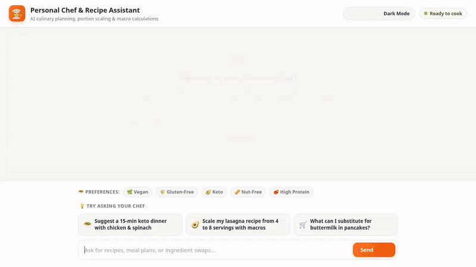

# Personal Chef & Recipe Assistant



A conversational AI assistant built with the **Google Agent Development Kit (ADK)**, designed to assist home cooks with meal planning, dietary preferences, custom recipe management, photorealistic food visuals, video generation, and culinary math.

---

## 🌟 Key Features & Capabilities

The agent is powered by `gemini-2.5-flash` with Vertex AI integration and includes the following fully implemented tools and services:

* **🧠 Cross-Session Long-Term Memory (Vertex AI Memory Bank)**
  * Remembers dietary preferences (e.g., keto, vegan, gluten-free), food allergies, ingredient dislikes, and cooking skill levels across user sessions using `PreloadMemoryTool` and callback hooks.

* **🍲 Recipe Catalog & Database (Google Cloud Firestore)**
  * **Search Recipes (`search_recipes`)**: Query local recipe catalog in Firestore filtered by title, tags, or dietary restrictions.
  * **Get Recipe Details (`get_recipe_details`)**: Retrieve full ingredient lists, preparation steps, and macro breakdowns by recipe ID.
  * **Add Custom Recipes (`add_recipe`)**: Save user-submitted or generated custom recipes directly to Firestore.

* **🖼️ Photorealistic AI Food Image Generation (Vertex AI Imagen)**
  * **AI Image Tool (`generate_ai_recipe_image`)**: Generates photorealistic dish visual representations using Vertex AI, automatically saves them as ADK artifacts, and publishes them to a public Google Cloud Storage (GCS) bucket.

* **🎥 AI Food Video Generation (Google Omni Model / Vertex AI)**
  * **AI Video Tool (`generate_ai_recipe_video`)**: Generates short 5-second dish/technique videos using `gemini-omni-flash-preview` in the `global` region via the Vertex AI Interactions API, saving artifacts and hosting on public Cloud Storage.

* **📊 Culinary Math & Code Execution (Agent Platform Sandbox)**
  * **Python Code Sandbox (`AgentEngineSandboxCodeExecutor`)**: Executes python code in an isolated sandbox environment to solve complex portion scaling, unit conversions, and calorie/macro calculations.

* **🎨 Rich Display UI (A2UI - Agent to UI)**
  * Automatically formats recipe cards, ingredient lists, and image visuals into native A2UI JSON card arrays for rich rendering in `adk web` and the custom web frontend.

* **📍 Geocoding & Local Store Lookup**
  * **Geocoding (`geocode_address`)**: Converts city names or physical addresses into geographical coordinates.
  * **Nearby Places (`find_nearby_places`)**: Locates nearby grocery stores, supermarkets, and specialty food markets.

* **🔍 Global Recipe Search**
  * **Search Global Recipes (`search_global_recipes`)**: Fetches external real-world recipes and culinary inspiration.

---

## 🛠️ Project Structure

```
personal-chef-agent/
├── app/
│   ├── agent.py            # Main ADK Agent definition, system prompt, and tools
│   ├── a2ui_utils.py       # A2UI schema manager and renderer callbacks
│   ├── memory_utils.py     # Vertex AI Memory Bank callbacks
│   └── main.py             # FastAPI backend server
├── frontend/
│   └── static/
│       ├── index.html      # Custom web UI with theme switcher & prompt shortcuts
│       └── style.css       # Design system styles
├── agents-cli-manifest.yaml # Agent Runtime deployment manifest
├── demo.gif                # Demonstration GIF recording
└── requirements.txt        # Python dependencies
```

---

## 🚀 Setup & Local Execution

Follow these steps to run the Personal Chef Agent locally on your machine.

### Prerequisites

* Python 3.10+
* Google Cloud SDK (`gcloud` CLI) authenticated to your GCP project

### 1. Environment Setup

Clone the repository and install required dependencies:

```bash
git clone <repository-url>
cd personal-chef-agent
pip install -r requirements.txt
```

Set your active Google Cloud Project ID:

```bash
gcloud auth login
gcloud auth application-default login
export GOOGLE_CLOUD_PROJECT="your-gcp-project-id"
```

### 2. Running the Agent

You can interact with the agent using either the ADK Web interface or the custom web frontend:

#### Option A: Run via ADK Web CLI
```bash
adk web app
```
*Opens the standard ADK Playground for testing tools, memory persistence, and A2UI output.*

#### Option B: Run Custom Web Frontend
```bash
python app/main.py
```
*Launches the custom FastAPI server serving the branded frontend UI.*

---

## 📄 License

Distributed under the Apache 2.0 License.
